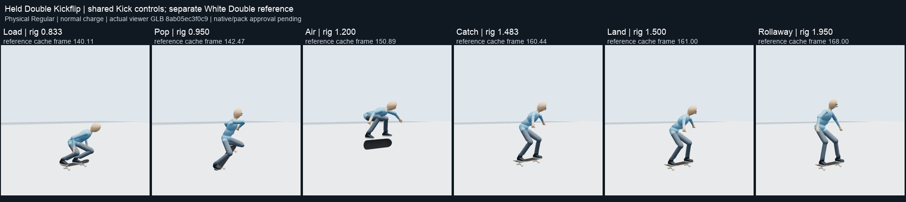
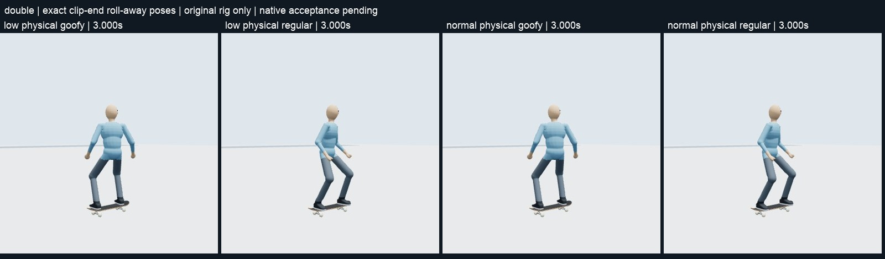
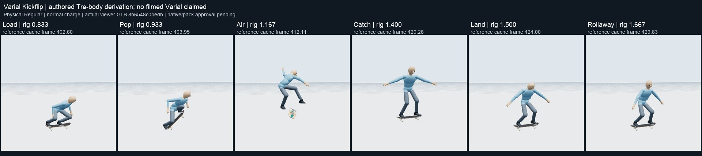
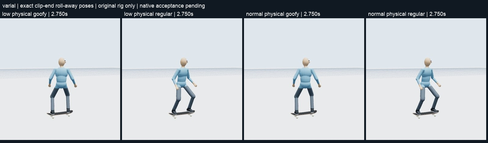
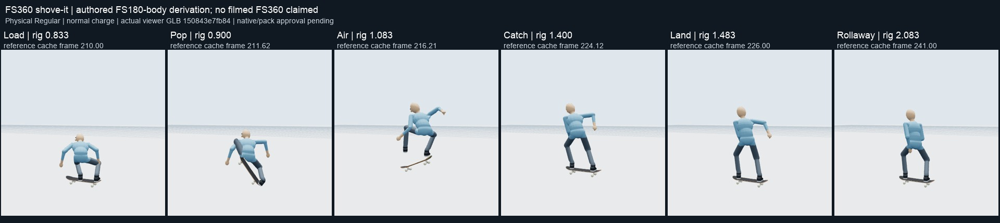
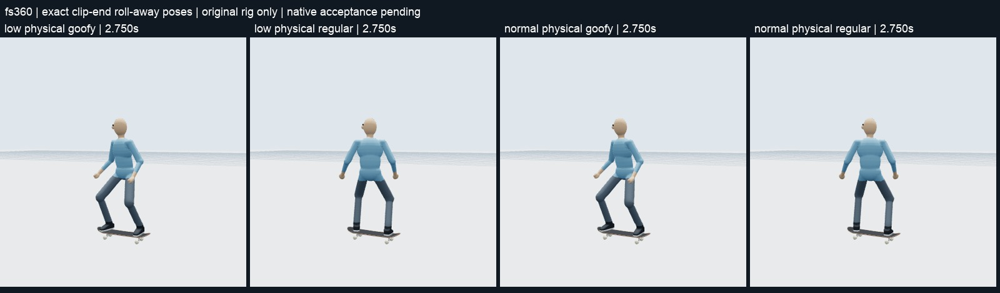
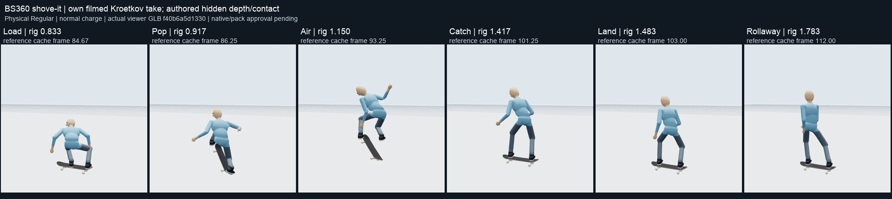
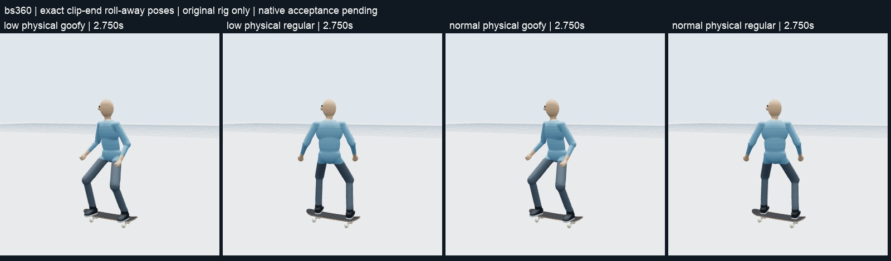

# Four-family visual handoff — 1 November 2026

These are Codex's viewer comparisons for Claude's quality gate in
[#584](https://github.com/Dj-Shortcut/rust-skate-mod/issues/584). Claude maintains
the [library record](RUST-SKATE-ANIMATION-LIBRARY.md). This handoff does not move
any library cell, set a pack to `reviewed=true`, or approve native gameplay.

The images contain only our rider and detailed thirteen-part skateboard.
Private Berrics video, source-frame pixels, detector output and generated
capture packs are excluded. Each phase image identifies the displayed rig time
and corresponding reference-cache frame. The
[manifest](review-media/2026-11-01-four-families/review-manifest.json) binds the
images to their GLB, source revision, pack hash, physical stance and playback
coverage. Requested/native stance names differ from the frozen proxy's physical
stance; the image labels use the audited physical leading foot.

## What was inspected

- Six actual displayed phase pairs per selection: Load, Pop, Air, Catch, Land
  and Rollaway. All **96 pairs** waited for the reference video to leave its
  seeking/poster state. A poster was not counted as a source comparison.
- **Sixteen selections:** four families, normal/low charge and physical
  Regular/Goofy. Normal and quarter-speed viewer playback was sampled
  consecutively through the last frame window, within 0.035 seconds of the
  endpoint; exact final poses were also sought separately for every selection.
- Deep preparation, pop/sole release, full board rotation, head/neck, free-foot
  clearance, catch, landing absorption and return to ordinary riding were
  compared beside the private reference. No visible extra leg swing or
  post-landing shaking was found in the inspected return sequences.
- Live canvas readback is below 60 Hz. Held Double additionally had the stored
  60 Hz GLB frames from 0.900 through 1.683 seconds inspected in all four
  selections. This is not a claim that every native frame was watched.

The private viewer transport initially stopped at quarter speed when a late
source-clock slope requested an unsupported video rate (0.046 instead of the
browser's 0.0625 minimum). The four private viewers now pause and seek exact
reference frames for those segments while keeping rig time authoritative.
No rate clamping, animation retiming, pose, physics or pack change was used to
hide the fault. The successful replay records contain no page errors.

## Observations and decisions still requested

| Family | Reference and visible result | Gate question / remaining correction |
| --- | --- | --- |
| Held Double Kickflip (#662, #663) | Shared ordinary-Kick controls plus the independently checked [White Double take, 480–492 s](https://www.youtube.com/watch?v=_oRoo1x1uzM&t=480). Deep normal Load, tail pressure, two turns under a compact body, bent catch/landing and stable upright return. | Claude's visual decision remains open. The independent Double is a different take; filmed stance and edit speed are uncertain. The low charge has a shallower Load. |
| Varial Kickflip (#640) | Authored half-turn shove/full-flip path with the [shared Tre body near 253 s](https://www.youtube.com/watch?v=_oRoo1x1uzM&t=253). The board turns underneath the free feet; balance arms settle into a steady return. | No filmed Varial take is claimed. Catch is straighter than Double's; the shared Tre reference is also relatively straight/blurry there. Claude should judge that visible catch before promotion; no arbitrary deeper squat was added. |
| FS360 shove-it (#653) | Authored full-turn deck path using the [Sewa FS pop shove reference, 130–133 s](https://www.youtube.com/watch?v=YcmPDIj2BFo&t=130). Gathered Air, separate free-foot pickup and stable return are visible. | **Pop still needs correction:** the reference extends before tail strike while the rig stays crouched too long. A separate source-clock repair is claimed in [#584](https://github.com/Dj-Shortcut/rust-skate-mod/issues/584#issuecomment-6557184280). These images deliberately retain the old revision. No filmed FS360 take is claimed; do not promote this frozen version. |
| BS360 shove-it (#602) | Its own [Kroetkov take near 150.8 s](https://www.youtube.com/watch?v=YcmPDIj2BFo&t=150), local frames 78–125 of the 148 s cache. Raised balance arm agrees with the source; steep deck pickup, full shove, bent catch/landing and steady return are visible. | Claude's visual decision remains open. Hidden depth, shoes and arm depth remain authored reconstruction. |

## Held Double

| Charge | Physical Regular | Physical Goofy |
| --- | --- | --- |
| Normal | [Six phases](review-media/2026-11-01-four-families/double-normal-regular.jpg) | [Six phases](review-media/2026-11-01-four-families/double-normal-goofy.jpg) |
| Low | [Six phases](review-media/2026-11-01-four-families/double-low-regular.jpg) | [Six phases](review-media/2026-11-01-four-families/double-low-goofy.jpg) |

## Varial Kickflip

| Charge | Physical Regular | Physical Goofy |
| --- | --- | --- |
| Normal | [Six phases](review-media/2026-11-01-four-families/varial-normal-regular.jpg) | [Six phases](review-media/2026-11-01-four-families/varial-normal-goofy.jpg) |
| Low | [Six phases](review-media/2026-11-01-four-families/varial-low-regular.jpg) | [Six phases](review-media/2026-11-01-four-families/varial-low-goofy.jpg) |

## FS360 — correction pending

| Charge | Physical Regular | Physical Goofy |
| --- | --- | --- |
| Normal | [Six phases](review-media/2026-11-01-four-families/fs360-normal-regular.jpg) | [Six phases](review-media/2026-11-01-four-families/fs360-normal-goofy.jpg) |
| Low | [Six phases](review-media/2026-11-01-four-families/fs360-low-regular.jpg) | [Six phases](review-media/2026-11-01-four-families/fs360-low-goofy.jpg) |

## BS360

| Charge | Physical Regular | Physical Goofy |
| --- | --- | --- |
| Normal | [Six phases](review-media/2026-11-01-four-families/bs360-normal-regular.jpg) | [Six phases](review-media/2026-11-01-four-families/bs360-normal-goofy.jpg) |
| Low | [Six phases](review-media/2026-11-01-four-families/bs360-low-regular.jpg) | [Six phases](review-media/2026-11-01-four-families/bs360-low-goofy.jpg) |

The local viewers remain available for motion inspection:
[Double](http://127.0.0.1:52184/viewer/),
[Varial](http://127.0.0.1:63761/varial-kickflip-review-640/),
[FS360](http://127.0.0.1:63761/fs360-shove-review-current/) and
[BS360](http://127.0.0.1:63761/bs360-shove-review-current/).
The GitHub images above provide the review handoff without requiring localhost
access. They do not replace the separate controller, avatar, mounting, compass
binding, pack approval or validated Shadow-package gates.
